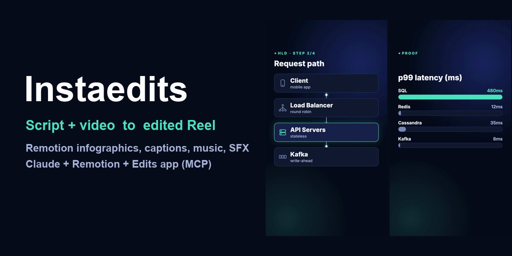
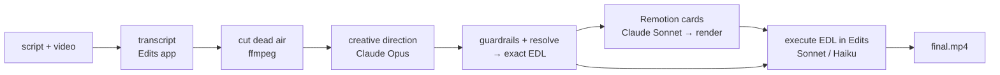

<div align="center">



# Instaedits

**AI video editing pipeline for Instagram Reels, TikTok and Shorts.**
Give it your script and your talking-head video — get back an edited short-form video with animated infographics, styled captions, background music and sound effects.

[](https://github.com/yashm1/instaedits/actions/workflows/test.yml)
[](LICENSE)


</div>

Built for creators who explain technical topics (system design, HLD/LLD, AI) and want **high-retention edits without AI slop**: every card carries new information, the hook works with the sound off, and the numeric rules are enforced in code — not just requested in a prompt.


## What you get
- **Creative direction by Claude Opus** — which infographic appears on which spoken phrase, punch-in zooms, caption style and keyword highlights, music choice and levels, SFX cues, light colour grade.
- **Remotion infographics** — Hook, architecture Flow (animated data packets), Fanout, Steps, Chart, syntax-highlighted Code, count-up Stat, Compare, Bullets. One hero accent on dark, Instagram safe zones built in.
- **Dead-air removal** (pauses > 0.4 s) and **exact timing**: your script is what you speak, so each card is placed on the real word, not an estimate.
- **Assembly in the [Edits](#prerequisites) desktop app** via MCP: overlays + transitions, captions, music with ducking, SFX, grade, export 9:16 1080×1920.
- **Token-lean by design**: only 3 of 9 steps use an LLM, each with a hard USD cap; everything else is local code. Cached artifacts mean re-runs don't re-pay.
- **Local dashboard** showing every step, model, tokens and cost live.

## How it works

Principle: **decide once, execute mechanically.** One strong model decides everything creative; the rest follows an exact list. Details in [docs/architecture.md](docs/architecture.md), research behind the editing rules in [docs/research.md](docs/research.md).

## Prerequisites
- **macOS** and the **Edits desktop app** (open, with Automation enabled in Settings). It is the only supported editor and an *unofficial* integration.
- **[Claude Code](https://claude.com/claude-code) CLI**, logged in (LLM steps run through it and bill your plan).
- `ffmpeg` / `ffprobe` on your PATH, **Node ≥ 22.18**.

## Quick start
```bash
git clone https://github.com/yashm1/instaedits && cd instaedits
npm run setup                      # installs Remotion deps
cp .env.example .env.local         # paste your Edits token (Settings → Automation → Access token)
npm start                          # → http://127.0.0.1:4399
```
Paste your script, enter the absolute path to your video, pick **Fast** (Haiku) or **High** (Sonnet + frame QA), and run. Tick *Dry run* to stop before the Edits app (plan + render only, ≈ $0.15). Jobs run one at a time; use *Re-run from here* to resume any step.

## Configuration
All environment-specific values live in [`server/config.mjs`](server/config.mjs) and can be overridden by env vars ([`.env.example`](.env.example)): models **by role**, per-step USD caps, port, jobs directory, canvas.

## Status & limitations
**Beta.** Planning, rule enforcement, timing resolution and rendering are tested (`npm test`, 80+ tests). The final step — an LLM driving the Edits app (captions placement, music/SFX search, export) — depends on a closed-source app's tool surface and may need prompt tuning on your machine. Other known limits:
- Edits app only, macOS only. Overlays are opaque full-frame cards (no alpha).
- A repeated anchor phrase resolves to its first occurrence.
- Editing rules are heuristics distilled from low-evidence sources — measure your own retention.

## Security
Local, single-user tool: binds to `127.0.0.1`, rejects foreign `Host`/`Origin`, JSON-only POST, validated ids and paths, capped budgets, token passed via a private temp file. See [SECURITY.md](SECURITY.md).

## FAQ
**Does my video get uploaded?** Your video file is processed locally (ffmpeg, Remotion, the Edits app). Claude receives text only: your script, sentence timings, the storyboard, and — in High mode — a few preview frames during the quality check.

**What does the Edits app do with my audio?** Transcription and the music/SFX libraries are provided by the Edits app itself; whether any of that happens in its cloud is governed by *its* privacy policy, not this project. Check it if your footage is sensitive.

**How much does a run cost?** The LLM steps are capped (defaults: direction $1, codegen $0.50, edit $1.50 fast / $3 high). Typical direction + codegen is around $0.15 for a 25-second reel.

**Can I use other editors (CapCut, Premiere, DaVinci)?** Not currently — Edits only.

**Can I swap models?** Yes, per role via `config.mjs` or `INSTAEDITS_MODEL_*` env vars.

**Is it for TikTok / YouTube Shorts too?** The canvas is 9:16, so yes; the safe zones are tuned for Instagram.

## Third-party licences — please read
This repo is MIT, but it **depends on [Remotion](https://www.remotion.dev), which has its own license**: free for individuals, non-profits and for-profit organisations with up to 3 employees; larger companies need a Company License. See [THIRD_PARTY.md](THIRD_PARTY.md).

## Contributing
PRs welcome — read [CONTRIBUTING.md](CONTRIBUTING.md) (PR + tests + self-review, no direct commits to `main`). Please follow the [Code of Conduct](CODE_OF_CONDUCT.md).

## License
[MIT](LICENSE) © 2026 Yash Mantri

<sub>Keywords: AI video editor, Instagram Reels automation, short-form video, Remotion, Claude, Claude Code, MCP, content creation, infographics, auto captions, video retention, faceless explainer, system design videos.</sub>
