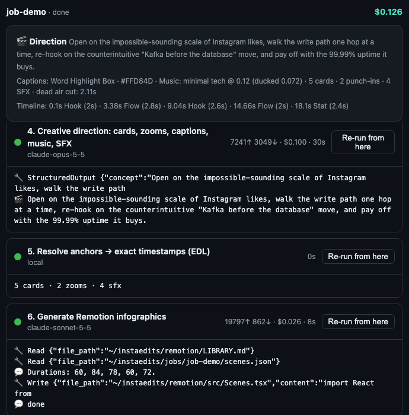
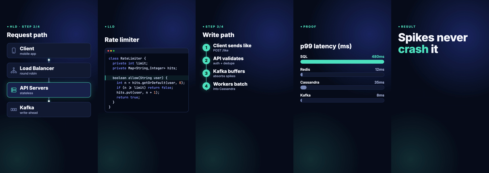
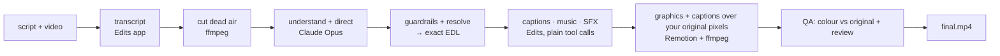

<div align="center">

# Instaedits

### Turn a script and a talking-head video into a finished, high-retention Reel.

AI-directed short-form video editing: split-screen Remotion infographics and real app screenshots above you, Hinglish captions, music and sound effects — placed on the exact words you speak.

[](https://github.com/yashm1/instaedits/actions/workflows/test.yml)
[](LICENSE)


[Quick start](#quick-start) · [Example](#a-real-run-end-to-end) · [How it works](#how-it-works) · [Editing rules](#editing-rules-enforced-in-code-where-possible) · [Troubleshooting](#troubleshooting) · [FAQ](#faq)


<sub>Real output: 5 cards the pipeline planned and rendered from a 25-second script about how Instagram handles likes.</sub>

</div>

## Why

Most "AI video editors" cut your footage and sprinkle effects. Instaedits works like an editor-in-chief with a checklist:

1. **One strong model decides everything creative, once** — what to show on which sentence, where to zoom, how loud the music is, which captions to emphasise.
2. **Everything after that is mechanical** — local code resolves the decisions into exact timestamps, Remotion renders the whole picture (cards in the top half, you in the bottom half), and plain code drives your editor with exact values. No model improvises inside the editor.
3. **Where a rule can be checked, it is enforced in code** — a bad generation can't ship a 12-word hook, music louder than your voice, or a black-and-white export.
4. **It watches the result before calling it done** — the export is compared with the render (colour, length, every card at its time), and in Full mode a model reviews a contact sheet against what you're saying.
5. **It's cheap on purpose**: a handful of small LLM calls (translation only for non-English speech), each with a hard dollar cap.

Built for creators who explain technical topics — system design (HLD/LLD), AI, engineering — but nothing in it is specific to tech.

## Quick start

```bash
git clone https://github.com/yashm1/instaedits && cd instaedits
npm run setup                  # installs Remotion (once)
cp .env.example .env.local     # paste your Edits access token (Settings → Automation)
npm start                      # → http://127.0.0.1:4399
```

Open the dashboard and press **Browse…** to pick your video in the native macOS file dialog (or click a recent one, or paste a path). Optionally add the links you talk about (e.g. your GitHub repo) and names to spell right, then choose **Reuse** (fast: unchanged steps from earlier runs are reused) or **Start fresh** (a completely new take), and press **Create reel**. Each reel gets its own page: the finished video plays right there, next to the quality checks, the reviewer's notes, a frame of every card, **Show in Finder** and **Download** — and the step timeline below (parallel steps side by side; reused steps marked). **More options → Dry run** plans and renders without opening Edits.

**Prerequisites:** macOS · the **Edits** desktop app, open, with Automation enabled (the only supported editor; unofficial integration) · [Claude Code](https://claude.com/claude-code) CLI, logged in · `ffmpeg`/`ffprobe` on PATH · Node ≥ 22.18 · optional: **Screen Recording** permission for your terminal (for real screenshots of the Edits app).

<div align="center">

<br><sub>The dashboard: create a reel on the left, your reels as a grid of real thumbnails on the right; each reel opens its own page with the video, checks and step timeline. Any step can be re-run without re-paying for earlier ones.</sub>
</div>

## No script? Hindi video? No problem

The script is **optional**. Leave it empty and Instaedits transcribes your audio. Pick the spoken language in the dashboard:

- **English, no script** — the transcript *is* the script; no extra LLM call.
- **Hindi (or another language)** — the audio is transcribed, **translated to English sentence by sentence**, and every card, hook and stat is written in **English**. **Captions are Latin-script Hinglish** ("bhai ye pura video Claude ne edit kiya hai"), written by a small model with a deterministic fallback so no Devanagari ever reaches the screen. Cards are placed by sentence number (`#3`) plus the exact spoken word, so timing never depends on matching words across languages.

Hinglish needs care: speech recognition often drops the English words inside Hindi speech (Kafka, `99.99%`). Instaedits runs a **second, English-model pass** over the same audio and gives the translator both versions; where a word is still missing it writes `[?]` and the director avoids building claims on it. Names that recognition mishears (it hears *Remotion* as "emotion") are fixed with a glossary: the **Terms** field, or the default list in `config.mjs`.

## Mention a tool or a GitHub repo? It shows the real thing

When the speaker names an open-source project or a tool, the director can add a **Repo** card (live stars, forks, language, licence from GitHub) or a **Site** card (a real screenshot of the official site in a browser frame). The director only proposes `owner/name` or a URL; **the pipeline then goes and verifies it** — a repo that doesn't exist on GitHub, or a site that won't load, is silently dropped (and shown as ❌ in the dashboard) rather than putting a wrong claim on screen. At most 3 per video.

Safety: fetched text and images go straight to Remotion — **never to an LLM** — so a web page can't inject instructions into the pipeline. Every URL passes an SSRF guard (https only, public hosts only, no ports, DNS results checked, redirects re-checked) so a model-suggested URL can't reach your local network or the Edits app. Set `GITHUB_TOKEN` (no scopes needed) to raise GitHub's limit from 60 to 5000 requests/hour.

## Real screenshots of your tools

Talking about the Edits app or its Automation (MCP) server? Instaedits captures **real screenshots** of the Edits editor (with your video on the timeline) and the Automation settings, and the director shows them as **Screen** cards. The access token on the settings screen is found with on-device OCR (Apple Vision) and painted over; the result is OCR'd again and **discarded if anything token-like is still readable**. Screenshots stay local (`screens/`, gitignored) and are never sent to a model.

Prefer your own screenshot? `npm run screens -- edits-automation ~/Desktop/automation.png` — it goes through the same redaction (fail closed) and auto-capture never overwrites it. `npm run screens` re-captures everything now.

GitHub repos are shown as the **actual repo page** (a fresh screenshot of `github.com/owner/name`), not a stats card.

## Optional: face-tracked effects on you

`npm run effects:install` adds [claude-video-effects](https://github.com/Vibha-Ramprakash/claude-video-effects) (MIT, by Vibha Ramprakash): a word dropping in **behind your head**, a spotlight, a tape label on your chest, an Instagram comment typing itself, a Follow button tap, a checklist under your chin and more. The director then uses 1–4 of them as pattern interrupts in full-frame speaker stretches, on the spoken word, never under a card — with the comment box / Follow tap at the call to action. Only short slices around each effect are rendered (in parallel with Edits and the graphics) and swapped in inside the effect windows; everywhere else your original pixels stay untouched. Without the install, nothing changes.

## What you get

Whenever a card shows, the frame **splits**: the card fills the top half, you stay visible in the bottom half (animated open/close, a thin ink seam). For one or two big moments per video — a multi-step diagram, the payoff number, a real screen worth reading, the call to action — a card goes **full screen** (your voice continues, captions turn to ink on paper). Between cards you're full-frame, with occasional punch-ins.

**The look is editorial, not "AI":** warm paper, ink, and one burnt-orange accent — no gradient backgrounds, no glows, no neon (a test enforces it). And **nothing is text-only**: icons draw themselves on, a highlighter sweeps the key word, checklists tick, numbers fill a ring, data packets travel through diagrams, and on real screenshots a cursor glides to the thing being talked about and clicks.


| Card | Use it for |
|---|---|
| **Hook** | The ≤4-word opener, mid-video re-hook, payoff line |
| **Flow** | Request paths and pipelines, with animated data packets (HLD) |
| **Fanout** | One → many: load balancer → servers, topic → consumers |
| **Steps** | Numbered lifecycles and algorithms |
| **Chart** | Latency / throughput / cost comparisons |
| **Code** | Syntax-highlighted code that types in (LLD) |
| **Stat** | A big count-up number: `99.99%`, `1.2M` |
| **Compare / Bullets** | Trade-offs and takeaways |
| **Repo** | A *real* GitHub repo — avatar, description, ★ count-up, forks, language, licence — fetched live |
| **Site** | A *real* screenshot of a tool's official site (or a GitHub repo page) in a browser frame, with its icon and description |
| **Screen** | A *real*, token-redacted screenshot of the Edits app (editor or Automation settings), slowly pushing in |



Plus: **punch-in zooms**, **Hinglish captions** in 2–3-word lines (on the seam while a card shows, so your face stays clear), **ducked licensed music**, **SFX on card entries**, **voice loudness at −14 LUFS**, **dead-air removal** (pauses > 0.4 s) and an export at **your camera's own resolution** (1440×2560 from a 1440-wide phone clip — never downscaled; graphics are rendered at that resolution too), visually lossless (x264 CRF 12, AAC 320k). No colour grade, no colour conversion: your footage never passes through the browser renderer, and QA fails any export whose colour drifts more than 2.5 levels from your original.

## How it works



| # | Step | Runs on | LLM? |
|---|---|---|---|
| 1 | Probe the video | ffprobe | — |
| 2 | Word-level transcript — **cached per video** (same clip is never uploaded twice) | Edits app (captions model) | — |
| 3 | Cut dead air → `tight.mp4` — cached | ffmpeg | — |
| 4 | **Translate to English** (non-English speech only), with the glossary — cached by prompt | Claude Sonnet | ✅ |
| 5 | **Director, two passes:** (1) a *script breakdown* — topic, promise, open loop, three candidate hooks, a role for every sentence, a second-by-second plan for the first 5 s, attention risks; (2) the *shot list* built from it — cached by prompt | Claude Opus | ✅ |
| 6 | **Fetch real visuals** for named tools / repos (verified, see above) — page screenshots reused for a day | GitHub API + headless Chrome | — |
| 7 | Guardrails, then anchors → exact timestamps (the EDL) | local | — |
| 8 | **Captions** straight from the transcript (exact word times) → ≤3-word Latin-script Hinglish lines — cached | Claude Sonnet | ✅ |
| 9a ‖ | **Edits**: licensed music, SFX, voice enhance → the audio mix — exact tool calls, cached | Edits app | — |
| 9b ‖ | **Graphics + captions** rendered on transparency — cached, runs **in parallel** with 9a | Remotion | — |
| 10 | **Composite** your **original camera pixels** under the graphics (moved/zoomed, never colour-converted), Edits audio at −14 LUFS — cached | ffmpeg | — |
| 11 | **QA** (checks run in parallel): colour vs your original, first frame = hook, every card at its time, length; Full mode: a model reviews a contact sheet | ffmpeg (+ Claude Sonnet) | ✅ (Full only) |

The director names the sentence *and the spoken word* for each card; the resolver finds that word in the real transcript, so cards land as the thing is said, not on a guessed timestamp. Deep dive: [docs/architecture.md](docs/architecture.md).

## A real run, end to end

<details>
<summary><b>Show the script → direction → timeline for the 25-second demo above</b></summary>

**You provide:** the script ("Ever wondered how Instagram handles millions of likes per second? Step one, the client hits a load balancer…") and the video.

**The director returns** (excerpt of `direction.json`):
```jsonc
{ "anchor": "Ever wondered how Instagram handles", "kind": "Hook",
  "props": { "text": "Millions of likes/sec", "hot": ["Millions"], "tag": "HLD" } }
{ "anchor": "Step one, the client hits", "kind": "Flow",
  "props": { "title": "The write path", "tag": "STEP 1/3", "highlight": "Load balancer",
             "nodes": [{ "label": "Client" }, { "label": "Load balancer" }, { "label": "API servers", "note": "stateless" }] } }
{ "anchor": "ninety nine point nine nine", "kind": "Stat",
  "props": { "value": "99.99%", "label": "uptime", "tag": "RESULT" } }
// captions: "Word Highlight Box", #FFD84D · music: "minimal tech" at 0.12, ducked to 0.072
```

**Local code resolves it to an exact timeline** (`edl.json`, on the tightened video):
```
0.10s  Hook   (2.0s)   whoosh 0.40 at 0.05s
3.38s  Flow   (2.8s)   whoosh 0.32
9.04s  Hook   (2.6s)   ← mid-video re-hook ("Likes are written to Kafka first…")
14.66s Flow   (2.0s)
18.10s Stat   (2.4s)   riser starts 0.9s earlier
zooms: 12.4s +1.2s → 110%,  20.7s +1.2s → 112%        (only where no card is showing)
```
Edits adds captions, music and SFX with plain tool calls; Remotion renders the graphics and captions on that exact timeline over your original footage. Nothing re-times it.
</details>

## Fast re-runs: nothing is computed twice

Every step's output is stored in a **content-addressed cache** (`cache/`, gitignored), keyed by a hash of everything that shapes it: the video's bytes, the cuts, the exact prompt, the card props, the Remotion sources, the music/SFX list. Re-run the same video (a new job or "Re-run from here") and unchanged steps return instantly — no upload, no tokens, no render. Change one thing and only the steps downstream of it recompute. Big renders are pruned least-recently-used beyond `INSTAEDITS_CACHE_MAX_GB` (default 8); `INSTAEDITS_CACHE=off` forces a full recompute.

**Want a different version instead?** Choose **Previous work → Start fresh** (or press **New take** on a finished reel). Nothing is reused: the video is re-transcribed, the screenshots and pages are re-captured, and the director — at higher effort — is shown this video's earlier takes and must pick a different angle, a new hook and different cards. Captions, the Edits audio mix, the graphics and a higher-quality final encode (CRF 12, `slow`) are all regenerated. The new results are cached too, so re-running *that* take is instant.

## Editing rules (enforced in code where possible)

The prompt carries the creative doctrine ([`server/prompts.mjs`](server/prompts.mjs)); [`server/guardrails.mjs`](server/guardrails.mjs) and the resolver enforce what can be enforced and log every correction (🛡) in the dashboard.

| Rule | How it's enforced |
|---|---|
| The hook is the strongest frame | **Code + tests:** the opening Hook owns **frame 0** (split already open, words already visible — it is the thumbnail), ≤ 4 words, key word on an accent block, optional real-screenshot backdrop; QA checks frame 0. Choosing the strongest line is an **instruction to the director** |
| Nothing sits still | **Code + tests:** speaker-only stretches get wide→tight framing changes (≤1.6 s apart in the first 6 s, ≤3 s after); every card reveals its content across its whole time on screen and moves with a slow push-in; cards enter/leave mid-motion in one direction |
| Proof by 4 s | **Instruction to the director**, checked by the resolver (logged when the first proof visual starts after ~4 s) |
| Text is readable | **Code + tests:** a card stays up ≥ 1 s per 2.5 words on it; captions appear 0.15 s before the word |
| Don't flood the viewer with sound | **Code + tests:** ≈ 1 SFX per 6 s, ≤ 1 riser, volumes clamped |
| Voice stays dominant | **Code + tests:** music ≤ 0.16, ducked to ≤ 0.6× |
| Cards are watchable | **Code + tests:** 1.5–5.5 s each, never overlapping; malformed cards dropped; zooms only in card-free gaps; three-of-a-kind in a row is *flagged*, not fixed |
| Cards land on the spoken word | **Code + tests:** sentence + word anchors resolved against the transcript |
| Colour is never altered | **Code + tests:** no grade tool is ever called; the speaker is composited from the original file; QA measures the export against your original (≤ 2.5 levels) |
| Captions readable, face clear | **Code + tests:** ≤ 3 words per line, split at real word gaps; on the seam during a card, at 72 % otherwise; Latin script only |
| Respect the platform UI | **Layout constants:** card content kept below the top bar; captions above the bottom 20 % |
| One hero colour | **Theme constants + WCAG contrast tests** |
| Every card adds new information | **Instruction to the director** — reviewed by the Full-mode QA model, not enforced by code |

The reasoning and its sources — including what we *didn't* trust — are in [docs/research.md](docs/research.md) and, for retention and motion quality (first 3 seconds, pacing, punch-ins, captions, easing), [docs/research-retention.md](docs/research-retention.md).

## Configuration

Everything environment-specific is in [`server/config.mjs`](server/config.mjs) and overridable with env vars ([`.env.example`](.env.example)).

| What | Default | Override |
|---|---|---|
| Director model | `claude-opus-5-5` | `INSTAEDITS_MODEL_DIRECTOR` |
| Hinglish captions model | `claude-sonnet-5-5` | `INSTAEDITS_MODEL_CAPTIONS` |
| QA reviewer model (Full) | `claude-sonnet-5-5` | `INSTAEDITS_MODEL_REVIEWER` |
| Spend caps per step | direction $1 · translate $0.3 · captions $0.3 · review $0.4 | API `budgets` |
| Glossary (names to spell right) | Remotion, Claude Code, Codex, Gemini, … | `INSTAEDITS_TERMS` or the dashboard's Terms field |
| Screenshots folder | `./screens` (reused for 7 days) | `INSTAEDITS_SCREENS_DIR` |
| Dashboard port | `4399` | `PORT` |
| Jobs directory | `./jobs` | `INSTAEDITS_JOBS_DIR` |
| Staging folder for the Edits app | `~/Movies/Instaedits` | `INSTAEDITS_STAGING_DIR` |
| Translator model | `claude-sonnet-5-5` | `INSTAEDITS_MODEL_TRANSLATOR` |
| GitHub API token (optional) | none (60 req/h) | `GITHUB_TOKEN` |

## Troubleshooting

| Symptom | Fix |
|---|---|
| `Edits rejected the request: set METAPILOT_TOKEN…` | Put the token from Edits → Settings → Automation into `.env.local`. |
| Transcribe step fails / "importMedia returned no id" | Open the Edits app (home or editor screen) and make sure Automation is enabled. |
| `Edits could not reach its transcription service` | Edits transcribes in the cloud. Check your internet connection, then **Re-run from here** (Instaedits already retries 4× with backoff). |
| `claude exited …` / login errors | Run `claude` once in a terminal and log in. |
| `ffprobe: command not found` | `brew install ffmpeg` |
| First render is slow | Remotion may download a headless browser on first use; later renders are fast. |
| `importMedia … Sandbox bookmark unavailable` | The Edits app is sandboxed and can't read arbitrary folders. Instaedits stages everything it needs in `~/Movies/Instaedits/<job>/` (hard links, no extra disk). If your Movies folder is elsewhere, set `INSTAEDITS_STAGING_DIR`. |
| Job shows `queued` | Jobs run one at a time (one editor, one Remotion workspace). Wait or cancel the running one. |
| Job stuck `running` after a crash | Restart `npm start`: interrupted jobs are marked resumable; use **Re-run from here**. |
| `rate limit reached — set GITHUB_TOKEN` | A Repo card couldn't be fetched. Add a scope-less `GITHUB_TOKEN` to `.env.local`. |
| Port already in use | `PORT=4500 npm start` |
| **Browse…** does nothing / “server is out of date” / the video doesn't play | The dashboard page is newer than the running server. Stop it (Ctrl-C) and run `npm start` again. The picker is the native macOS dialog — it can open behind the browser window. |
| A re-run did everything again | Re-runs reuse work only when inputs are identical (same video bytes, same options). Check that `INSTAEDITS_CACHE` isn't `off`; `cache/` can be deleted safely. |
| `edits-editor skipped` / `screen capture failed` | Give your terminal **Screen Recording** permission (System Settings → Privacy & Security), then restart it. Instaedits briefly brings Edits to the front to capture the editor. |
| `edits-automation skipped` | Open Edits → Settings → Automation once and leave the window open (reused for 7 days), or use your own: `npm run screens -- edits-automation <file.png>`. |
| `QA failed: colour lost …` / `card … not on screen` | The export doesn't match the render. Check the Edits project it left open, then **Re-run from here** on the Edits step. |

## Status & roadmap

**Beta.** Verified end to end on a real 24-second Hindi talking-head reel (10/10 steps, about $0.17 in model calls): split-screen cards on the spoken words, real screenshots of the Edits app (token redacted) and of the GitHub repo, Latin-script Hinglish captions, music, SFX, a 1080×1920 export — and QA confirming colour, length and every card at its time. 215+ tests and CI cover direction, guardrails, timing, the Edits executor (against a fake app), redaction and QA. Edits is a closed-source app whose automation API may change; if a step misbehaves, open an issue with the dashboard log.

Known limits: Edits' own video export (HEVC only) shifts colour slightly, so its picture is never used — only its audio and caption timing · the Edits transcription may drop English words in Hindi speech (mitigated by the second pass and the glossary, not eliminated) · macOS + Edits only · the Hinglish fallback transliteration is phonetic, not idiomatic · rendering a 25 s reel takes ~3 min · Voice Enhance depends on an app panel and is skipped (with a note) if the app refuses · the editing rules are heuristics from low-evidence sources, so measure your own retention.

Roadmap: end-to-end verification on more real videos · occurrence-aware anchors · brand/profile theming · more card types (timeline, graph) · an HTTP workflow API for integrations. Ideas and PRs welcome.

## FAQ

**Does my video get uploaded?** Instaedits itself uploads nothing: ffmpeg, Remotion and the Edits app run on your Mac, and your video is hard-linked into `~/Movies/Instaedits/<job>/` so the sandboxed Edits app can open it. Two things do leave your machine: **(1) the Edits app uploads your audio to its own servers to transcribe it** (we observed this: offline, transcription fails with `uploadFailed … Network is unreachable`), so an internet connection is required and Edits' privacy policy applies; **(2) Claude receives text only** — transcript sentences (and their English translation), timings and the storyboard — plus, in Full QA mode, one small contact sheet of frames from the export (one per card). Screenshots of the Edits app are never sent.

**What does the Edits app do with my audio?** Transcription is a cloud call made by the Edits app (see above), and its music/SFX libraries are fetched from its servers. Check Edits' privacy policy if your footage is sensitive.

**How much does a run cost?** Measured on a 24-second Hindi reel: translation ≈ $0.01, direction ≈ $0.11, Hinglish captions and the QA review a few cents each. The edit itself costs nothing — it's plain tool calls. Steps are cached, so re-runs are cheaper.

**Does it visit websites?** Only for Repo/Site cards: the GitHub API, and the official site of a tool the speaker names (opened in headless Chrome, public https hosts only). Nothing is sent from the page to an LLM.

**Can I use CapCut / Premiere / DaVinci?** Not currently — the Edits app only.

**Can I change models?** Yes, per role — see [Configuration](#configuration).

**Does it work for TikTok and YouTube Shorts?** The canvas is 9:16 so yes; the safe zones are tuned for Instagram.

**Is it only for tech content?** The card library and doctrine lean toward explaining systems, but you can add cards ([CONTRIBUTING.md](CONTRIBUTING.md#adding-a-card-type)) and edit the doctrine.

## Third-party licences — please read

This repo is MIT, but it **depends on [Remotion](https://www.remotion.dev), which has its own license**: free for individuals, non-profits and for-profit organisations with up to 3 employees; larger companies need a Company License. See [THIRD_PARTY.md](THIRD_PARTY.md). "Claude", "Remotion", "Edits" and "Instagram" are trademarks of their owners; this project is not affiliated with them.

## Contributing & security

PRs welcome — read [CONTRIBUTING.md](CONTRIBUTING.md) (branch → PR → tests → self-review; nothing goes straight to `main`) and the [Code of Conduct](CODE_OF_CONDUCT.md). Report vulnerabilities privately per [SECURITY.md](SECURITY.md).

## License

[MIT](LICENSE) © 2026 Yash Mantri

<sub>Keywords: AI video editor · Instagram Reels automation · short-form video · Remotion · Claude · Claude Code · MCP · content creation · infographics · auto captions · video retention · faceless explainer · system design videos.</sub>
