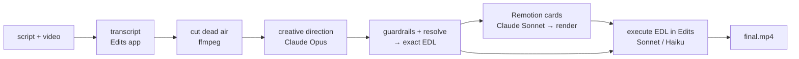

<div align="center">

# Instaedits

### Turn a script and a talking-head video into a finished, high-retention Reel.

AI-directed short-form video editing: animated infographics, styled captions, music and sound effects — placed on the exact words you speak.

[](https://github.com/yashm1/instaedits/actions/workflows/test.yml)
[](LICENSE)


[Quick start](#quick-start) · [Example](#a-real-run-end-to-end) · [How it works](#how-it-works) · [Editing rules](#editing-rules-enforced-in-code-where-possible) · [Troubleshooting](#troubleshooting) · [FAQ](#faq)


<sub>Real output: 5 cards the pipeline planned and rendered from a 25-second script about how Instagram handles likes.</sub>

</div>

## Why

Most "AI video editors" cut your footage and sprinkle effects. Instaedits works like an editor-in-chief with a checklist:

1. **One strong model decides everything creative, once** — what to show on which sentence, where to zoom, how loud the music is, which captions to emphasise.
2. **Everything after that is mechanical** — local code resolves the decisions into exact timestamps, Remotion renders the cards, a cheaper model just executes the list inside your editor.
3. **Where a rule can be checked, it is enforced in code** — a bad generation can't ship a 12-word hook or music louder than your voice.
4. **It's cheap on purpose**: only 3–4 of the 11 steps use an LLM (translation runs only for non-English speech), each with a hard dollar cap.

Built for creators who explain technical topics — system design (HLD/LLD), AI, engineering — but nothing in it is specific to tech.

## Quick start

```bash
git clone https://github.com/yashm1/instaedits && cd instaedits
npm run setup                  # installs Remotion (once)
cp .env.example .env.local     # paste your Edits access token (Settings → Automation)
npm start                      # → http://127.0.0.1:4399
```

Open the dashboard, enter the absolute path of your video (and, optionally, your script), choose **Fast** (Haiku) or **High** (Sonnet + frame-by-frame QA), and press **Run workflow**. Tick **Dry run** first to plan and render the cards without touching your editor (≈ $0.15).

**Prerequisites:** macOS · the **Edits** desktop app, open, with Automation enabled (the only supported editor; unofficial integration) · [Claude Code](https://claude.com/claude-code) CLI, logged in · `ffmpeg`/`ffprobe` on PATH · Node ≥ 22.18.

<div align="center">

<br><sub>The dashboard: every step, which model ran it, tokens, cost and time. Any step can be re-run from there without re-paying for earlier ones.</sub>
</div>

## No script? Hindi video? No problem

The script is **optional**. Leave it empty and Instaedits transcribes your audio. Pick the spoken language in the dashboard:

- **English, no script** — the transcript *is* the script; no extra LLM call.
- **Hindi (or another language)** — the audio is transcribed, **translated to English sentence by sentence**, and every card, hook and stat is written in **English**. Captions stay in the spoken language. Cards are placed by sentence number (`#3`), so timing never depends on matching words across languages.

Hinglish needs care: speech recognition often drops the English words inside Hindi speech (Kafka, `99.99%`). Instaedits runs a **second, English-model pass** over the same audio and gives the translator both versions; where a word is still missing it writes `[?]` and the director avoids building claims on it. If a term matters, put it in the optional script box as a hint.

## Mention a tool or a GitHub repo? It shows the real thing

When the speaker names an open-source project or a tool, the director can add a **Repo** card (live stars, forks, language, licence from GitHub) or a **Site** card (a real screenshot of the official site in a browser frame). The director only proposes `owner/name` or a URL; **the pipeline then goes and verifies it** — a repo that doesn't exist on GitHub, or a site that won't load, is silently dropped (and shown as ❌ in the dashboard) rather than putting a wrong claim on screen. At most 3 per video.

Safety: fetched text and images go straight to Remotion — **never to an LLM** — so a web page can't inject instructions into the pipeline. Every URL passes an SSRF guard (https only, public hosts only, no ports, DNS results checked, redirects re-checked) so a model-suggested URL can't reach your local network or the Edits app. Set `GITHUB_TOKEN` (no scopes needed) to raise GitHub's limit from 60 to 5000 requests/hour.

## What you get

| Card | Use it for |
|---|---|
| **Hook** | The ≤4-word opener, mid-video re-hook, payoff line |
| **Flow** | Request paths and pipelines, with animated data packets (HLD) |
| **Fanout** | One → many: load balancer → servers, topic → consumers |
| **Steps** | Numbered lifecycles and algorithms |
| **Chart** | Latency / throughput / cost comparisons |
| **Code** | Syntax-highlighted code that types in (LLD) |
| **Stat** | A big count-up number: `99.99%`, `1.2M` |
| **Compare / Bullets** | Trade-offs and takeaways |
| **Repo** | A *real* GitHub repo — avatar, description, ★ count-up, forks, language, licence — fetched live |
| **Site** | A *real* screenshot of a tool's official site in a browser frame, with its icon and description |


Plus, decided by the director and applied in the editor: **punch-in zooms**, **caption style + highlighted keywords**, **ducked background music**, **SFX on card entries**, a **subtle grade**, and **dead-air removal** (pauses > 0.4 s).

## How it works



| # | Step | Runs on | LLM? |
|---|---|---|---|
| 1 | Probe the video | ffprobe | — |
| 2 | Word-level transcript | Edits app (captions model) | — |
| 3 | Cut dead air → `tight.mp4` | ffmpeg | — |
| 4 | **Translate to English** (non-English speech only) | Claude Sonnet | ✅ |
| 5 | **Creative direction** | Claude Opus | ✅ |
| 6 | **Fetch real visuals** for named tools / repos (verified, see below) | GitHub API + headless Chrome | — |
| 7 | Guardrails, then anchors → exact timestamps (the EDL) | local | — |
| 8 | Write the Remotion scenes | Claude Sonnet | ✅ |
| 9 | Render the cards | Remotion | — |
| 10 | **Execute the EDL** in the editor | Claude Sonnet (High) / Haiku (Fast) | ✅ |
| 11 | Verify the export | ffprobe | — |

Because you speak the script verbatim, step 5 finds each card's anchor phrase in the real transcript — cards land on the right word, not on a guessed timestamp. Deep dive: [docs/architecture.md](docs/architecture.md).

## A real run, end to end

<details>
<summary><b>Show the script → direction → timeline for the 25-second demo above</b></summary>

**You provide:** the script ("Ever wondered how Instagram handles millions of likes per second? Step one, the client hits a load balancer…") and the video.

**The director returns** (excerpt of `direction.json`):
```jsonc
{ "anchor": "Ever wondered how Instagram handles", "kind": "Hook",
  "props": { "text": "Millions of likes/sec", "hot": ["Millions"], "tag": "HLD" } }
{ "anchor": "Step one, the client hits", "kind": "Flow",
  "props": { "title": "The write path", "tag": "STEP 1/3", "highlight": "Load balancer",
             "nodes": [{ "label": "Client" }, { "label": "Load balancer" }, { "label": "API servers", "note": "stateless" }] } }
{ "anchor": "ninety nine point nine nine", "kind": "Stat",
  "props": { "value": "99.99%", "label": "uptime", "tag": "RESULT" } }
// captions: "Word Highlight Box", #FFD84D · music: "minimal tech" at 0.12, ducked to 0.072
```

**Local code resolves it to an exact timeline** (`edl.json`, on the tightened video):
```
0.10s  Hook   (2.0s)   whoosh 0.40 at 0.05s
3.38s  Flow   (2.8s)   whoosh 0.32
9.04s  Hook   (2.6s)   ← mid-video re-hook ("Likes are written to Kafka first…")
14.66s Flow   (2.0s)
18.10s Stat   (2.4s)   riser starts 0.9s earlier
zooms: 12.4s +1.2s → 110%,  20.7s +1.2s → 112%        (only where no card is showing)
```
The editor model then follows that list. It makes no creative choices.
</details>

## Editing rules (enforced in code where possible)

The prompt carries the creative doctrine ([`server/prompts.mjs`](server/prompts.mjs)); [`server/guardrails.mjs`](server/guardrails.mjs) and the resolver enforce what can be enforced and log every correction (🛡) in the dashboard.

| Rule | How it's enforced |
|---|---|
| Hook works with sound off | **Code + tests:** opening Hook trimmed to ≤ 4 words, placed at 0.1 s |
| Don't flood the viewer with sound | **Code + tests:** ≈ 1 SFX per 6 s, ≤ 1 riser, volumes clamped |
| Voice stays dominant | **Code + tests:** music ≤ 0.16, ducked to ≤ 0.6× |
| Emphasis stays meaningful | **Code + tests:** ≤ 10 % of words highlighted |
| Cards are watchable | **Code + tests:** 1.5–4.5 s each; zooms only in card-free gaps; three-of-a-kind in a row is *flagged*, not fixed |
| Respect the platform UI | **Layout constants + tests:** top 14 % / bottom 20 % kept clear |
| One hero colour | **Theme constants + WCAG contrast tests** |
| Captions: 2–3 words per line at ~68 % height | **Instruction to the editor model** — checked by its frame QA pass in High mode, not by code |

The reasoning and its sources — including what we *didn't* trust — are in [docs/research.md](docs/research.md).

## Configuration

Everything environment-specific is in [`server/config.mjs`](server/config.mjs) and overridable with env vars ([`.env.example`](.env.example)).

| What | Default | Override |
|---|---|---|
| Director model | `claude-opus-5-5` | `INSTAEDITS_MODEL_DIRECTOR` |
| Code-gen model | `claude-sonnet-5-5` | `INSTAEDITS_MODEL_CODER` |
| Editor model (High / Fast) | `claude-sonnet-5-5` / `claude-haiku-5-5` | `INSTAEDITS_MODEL_EDITOR_HIGH` / `_FAST` |
| Spend caps per step | direction $1 · codegen $0.50 · edit $3 (High) / $1.50 (Fast) | the dashboard (edit step) |
| Dashboard port | `4399` | `PORT` |
| Jobs directory | `./jobs` | `INSTAEDITS_JOBS_DIR` |
| Staging folder for the Edits app | `~/Movies/Instaedits` | `INSTAEDITS_STAGING_DIR` |
| Translator model | `claude-sonnet-5-5` | `INSTAEDITS_MODEL_TRANSLATOR` |
| GitHub API token (optional) | none (60 req/h) | `GITHUB_TOKEN` |

## Troubleshooting

| Symptom | Fix |
|---|---|
| `Edits rejected the request: set METAPILOT_TOKEN…` | Put the token from Edits → Settings → Automation into `.env.local`. |
| Transcribe step fails / "importMedia returned no id" | Open the Edits app (home or editor screen) and make sure Automation is enabled. |
| `Edits could not reach its transcription service` | Edits transcribes in the cloud. Check your internet connection, then **Re-run from here** (Instaedits already retries 4× with backoff). |
| `claude exited …` / login errors | Run `claude` once in a terminal and log in. |
| `ffprobe: command not found` | `brew install ffmpeg` |
| First render is slow | Remotion may download a headless browser on first use; later renders are fast. |
| `importMedia … Sandbox bookmark unavailable` | The Edits app is sandboxed and can't read arbitrary folders. Instaedits stages everything it needs in `~/Movies/Instaedits/<job>/` (hard links, no extra disk). If your Movies folder is elsewhere, set `INSTAEDITS_STAGING_DIR`. |
| Job shows `queued` | Jobs run one at a time (one editor, one Remotion workspace). Wait or cancel the running one. |
| Job stuck `running` after a crash | Restart `npm start`: interrupted jobs are marked resumable; use **Re-run from here**. |
| `rate limit reached — set GITHUB_TOKEN` | A Repo card couldn't be fetched. Add a scope-less `GITHUB_TOKEN` to `.env.local`. |
| Port already in use | `PORT=4500 npm start` |

## Status & roadmap

**Beta.** The whole pipeline has now been run end to end — including the Edits app editing and exporting — on a synthetic Hindi test clip (11/11 steps, about $0.31). Direction, rule enforcement, timing resolution and rendering are covered by 180+ tests and CI. Real-footage testing is still ongoing, and a model driving a closed-source app may need prompt tuning on your machine; please open an issue with the dashboard log (and the *Editor's report* panel) if it misbehaves.

Known limits: overlay cards get fades, not transitions (the app's transition tool only works between adjacent clips) · the export may be HEVC when H.264 isn't offered · the Edits transcription may drop English words in Hindi speech (mitigated by the second pass, not eliminated) · macOS + Edits only · overlay cards are opaque full-frame · a repeated anchor phrase resolves to its first occurrence · the editing rules are heuristics from low-evidence sources, so measure your own retention.

Roadmap: end-to-end verification on more real videos · occurrence-aware anchors · brand/profile theming · more card types (timeline, graph) · an HTTP workflow API for integrations. Ideas and PRs welcome.

## FAQ

**Does my video get uploaded?** Instaedits itself uploads nothing: ffmpeg, Remotion and the Edits app run on your Mac, and your video is hard-linked into `~/Movies/Instaedits/<job>/` so the sandboxed Edits app can open it. Two things do leave your machine: **(1) the Edits app uploads your audio to its own servers to transcribe it** (we observed this: offline, transcription fails with `uploadFailed … Network is unreachable`), so an internet connection is required and Edits' privacy policy applies; **(2) Claude receives text only** — transcript sentences (and their English translation), timings and the storyboard — plus a few preview frames in High mode during the quality check.

**What does the Edits app do with my audio?** Transcription is a cloud call made by the Edits app (see above), and its music/SFX libraries are fetched from its servers. Check Edits' privacy policy if your footage is sensitive.

**How much does a run cost?** Direction + code-gen is about $0.15 for a 25-second reel (measured). The editing step is capped at $1.50 (Fast) or $3 (High); steps are cached, so re-runs are cheaper.

**Does it visit websites?** Only for Repo/Site cards: the GitHub API, and the official site of a tool the speaker names (opened in headless Chrome, public https hosts only). Nothing is sent from the page to an LLM.

**Can I use CapCut / Premiere / DaVinci?** Not currently — the Edits app only.

**Can I change models?** Yes, per role — see [Configuration](#configuration).

**Does it work for TikTok and YouTube Shorts?** The canvas is 9:16 so yes; the safe zones are tuned for Instagram.

**Is it only for tech content?** The card library and doctrine lean toward explaining systems, but you can add cards ([CONTRIBUTING.md](CONTRIBUTING.md#adding-a-card-type)) and edit the doctrine.

## Third-party licences — please read

This repo is MIT, but it **depends on [Remotion](https://www.remotion.dev), which has its own license**: free for individuals, non-profits and for-profit organisations with up to 3 employees; larger companies need a Company License. See [THIRD_PARTY.md](THIRD_PARTY.md). "Claude", "Remotion", "Edits" and "Instagram" are trademarks of their owners; this project is not affiliated with them.

## Contributing & security

PRs welcome — read [CONTRIBUTING.md](CONTRIBUTING.md) (branch → PR → tests → self-review; nothing goes straight to `main`) and the [Code of Conduct](CODE_OF_CONDUCT.md). Report vulnerabilities privately per [SECURITY.md](SECURITY.md).

## License

[MIT](LICENSE) © 2026 Yash Mantri

<sub>Keywords: AI video editor · Instagram Reels automation · short-form video · Remotion · Claude · Claude Code · MCP · content creation · infographics · auto captions · video retention · faceless explainer · system design videos.</sub>
