# Architecture

**Principle: decide once, execute mechanically.** One expensive model makes every creative decision up front; everything after is deterministic code or a cheap model following an exact list.

```mermaid
flowchart LR
  A[script + video] --> B[transcript<br/>Edits captions model]
  B --> C[cut dead air<br/>ffmpeg → tight.mp4]
  C --> D[understand + direct<br/>Opus · structured JSON]
  D --> G[guardrails<br/>enforced limits]
  G --> E[resolve anchors<br/>→ edl.json]
  E --> F[render the reel<br/>Remotion: speaker + cards, split screen]
  F --> H[Edits: Hinglish captions, music, SFX, export<br/>plain tool calls — no LLM]
  H --> Q[QA: export vs render + vision review]
  Q --> I[final.mp4]
```

## Contracts (the stable seams)
| File (in `jobs/<id>/`) | Produced by | Consumed by |
|---|---|---|
| `transcript.json` | Edits `transcribeClip` | cuts, direction, resolver |
| `transcript.alt.json` | Edits `transcribeClip` (English pass, non-English speech only) | translator |
| `sentences.json` | translator (numbered sentences + English) | director, resolver (`#N` anchors) |
| `assets.json` + `references.json` | `references.mjs` (GitHub API + headless Chrome) | Remotion `inputProps`; the resolver (drops unverified cards) |
| `tight.mp4` + `cuts.json` | ffmpeg | the editor (never re-cut) |
| `direction.json` | Opus, then guardrails | resolver |
| `edl.json` | resolver (anchors → exact seconds) | edit prompt |
| `reel.json` → `reel.mp4` | resolver → Remotion (`Reel.tsx`) → ffmpeg loudnorm | the Edits step (imported as one clip) |
| `screens/*.png` | `screens.mjs` (screencapture + Vision OCR redaction) | Screen cards |
| `qa/contact.jpg` | `qa.mjs` | the reviewer model, the dashboard |

## Modules (`server/`)
- `config.mjs` — every environment-specific value (models by role, caps, ports, canvas).
- `pipeline.mjs` — job state, ordered steps, serial queue, resume, stale-job recovery.
- `claude.mjs` — minimal `claude -p` runner (no skills/settings, scoped tools, USD cap, secrets via temp file).
- `edits-mcp.mjs` — tiny MCP client so Node can call the Edits app with zero LLM tokens.
- `media.mjs` — transcript math, dead-air cuts, sentence + word anchor matching, EDL resolver.
- `editor.mjs` — the Edits step as plain tool calls (no LLM): import the rendered reel, captions (≤3-word lines, Latin Hinglish, seam/full positions), music, SFX, a complete export preset. Never grades colour.
- `captions.mjs` — caption line splits, split windows, caption placement, Devanagari→Latin fallback.
- `screens.mjs` + `native/*.swift` — real Edits screenshots; tokens found by Apple Vision OCR, painted over, re-checked (fail closed).
- `qa.mjs` — export vs render: duration, saturation (black-and-white guard), SSIM of every card at its time; contact sheet.
- `references.mjs`, `netguard.mjs` — real Repo/Site visuals: the director only *proposes* `owner/name` / URL; this verifies them (GitHub API, headless-Chrome screenshot) behind an SSRF guard. Fetched data goes to Remotion only, never to an LLM.
- `guardrails.mjs` — numeric limits the prompt can only ask for.
- `prompts.mjs`, `catalog.mjs` — creative doctrine and the options verified to exist in the Edits app.
- `security.mjs`, `queue.mjs`, `index.mjs` — localhost hardening, one-job-at-a-time queue, HTTP/SSE API.

## Staging (the Edits app is sandboxed)
Edits can only open and write folders it has access to. Everything it touches — source video, `tight.mp4`, rendered cards, the export — is hard-linked into `~/Movies/Instaedits/<job>/` (`server/staging.mjs`). `jobs/` is never handed to Edits.

## Why jobs run one at a time
There is one Edits app to drive (and the screenshot step brings it to the front).

## Extending
New card → component in `lib/index.tsx` + the `KINDS` map in `Reel.tsx` + `LIBRARY.md` + `SCENE_KINDS` + `REQUIRED` props in guardrails (tests catch drift). New pipeline step → add a `STEP_DEFS` entry and a `STEPS` function. Different models → `config.mjs` / env.
