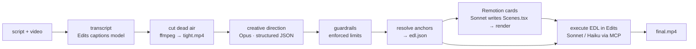

# Architecture

**Principle: decide once, execute mechanically.** One expensive model makes every creative decision up front; everything after is deterministic code or a cheap model following an exact list.

## Contracts (the stable seams)
| File (in `jobs/<id>/`) | Produced by | Consumed by |
|---|---|---|
| `transcript.json` | Edits `transcribeClip` | cuts, direction, resolver |
| `tight.mp4` + `cuts.json` | ffmpeg | the editor (never re-cut) |
| `direction.json` | Opus, then guardrails | resolver |
| `edl.json` | resolver (anchors → exact seconds) | edit prompt |
| `scenes.json` → `Scenes.tsx` → `clips/sN.mp4` | resolver → Sonnet → Remotion | the editor |

## Modules (`server/`)
- `config.mjs` — every environment-specific value (models by role, caps, ports, canvas).
- `pipeline.mjs` — job state, ordered steps, serial queue, resume, stale-job recovery.
- `claude.mjs` — minimal `claude -p` runner (no skills/settings, scoped tools, USD cap, secrets via temp file).
- `edits-mcp.mjs` — tiny MCP client so Node can call the Edits app with zero LLM tokens.
- `media.mjs` — transcript math, dead-air cuts, anchor matching, EDL resolver.
- `guardrails.mjs` — numeric limits the prompt can only ask for.
- `prompts.mjs`, `catalog.mjs` — creative doctrine and the options verified to exist in the Edits app.
- `security.mjs`, `queue.mjs`, `index.mjs` — localhost hardening, one-job-at-a-time queue, HTTP/SSE API.

## Why jobs run one at a time
There is one Edits app to drive and one shared Remotion workspace (`remotion/src/Scenes.tsx`).

## Extending
New card → component + `LIBRARY.md` + `SCENE_KINDS` (tests catch drift). New pipeline step → add a `STEP_DEFS` entry and a `STEPS` function. Different models → `config.mjs` / env.
